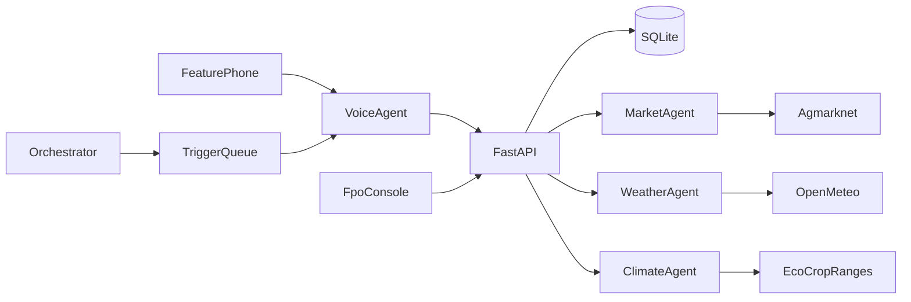

# RaithaLine architecture

A feature-phone line for ten Karnataka crops. The voice agent asks and speaks. This service decides what is true, who may be called, and what the SMS is allowed to say.

## Layers

A request reads the local table first. A live call happens only when that table cannot answer, and a successful live call is written back.

- Prices stay on the Agmarknet date-wise series already stored for the ten mandis. CEDA Agri Market Data at agmarknet.ceda.ashoka.edu.in is the cleaned version of that same feed, and its API needs a free key from api.ceda.ashoka.edu.in. No key is configured, so the line does not call CEDA and does not invent a second price.
- Rain reads `data/cache/weather.json`. Open-Meteo is called only when that forecast no longer covers today, and the new JSON replaces the cache.
- Climate reads FAO EcoCrop thresholds in `data/ecocrop.json` and the WorldClim cell deltas in `data/cache/worldclim.json`. Those deltas were sampled once from the 10-arc-minute GeoTIFFs and stored. The app does not open the rasters again.
- A farming question that is not a price or a rain question is matched against `data/kcc.json`, 200 Karnataka Kisan Call Centre rows for these crops. A hit is quoted with its record id. A miss is a refusal that names the Krishi Vigyan Kendra. If `DATA_GOV_API_KEY` is set, a miss may try one data.gov.in pull, and any rows that come back are stored in the `findings` table for the next call.

## Agents

- Market reads the loaded Agmarknet series for the crop's mandi. An FPO morning gate price, when the desk has one, replaces that day's modal and grade range. Tomato at Kolar also gets a 7-day ridge forecast and a Bengaluru comparison, spoken as an FPO pooled trip. A soft price is delay-harvest for tomato and banana, and a dry godown for the other eight. A harvested tomato or banana is a sell.
- Weather reads the cached Open-Meteo forecast. Twenty millimetres or more across the next two days suppresses a transport call.
- Climate scores the crop at Kolar or Kalaburagi, whichever was asked or is nearer, using FAO EcoCrop limits and 2015–2024 Open-Meteo normals. The 2041–2060 shift is the stored WorldClim cell delta for that district, temperature added and rainfall multiplied. The same card is spoken when a farmer marks the load in transit or completes the sale, comparing that crop with ragi and tur before the next sowing.

The weekly plan is those three claims joined into sentences. It does not add a price, a date, or a dose that no agent returned.

## Approval

A farmer is proposed only when all of these are true:

- they opted in
- the sowing is inside the call window for that crop
- they are not marked in transit
- the mandi advice is sell now, sell nearby, or the shortage rule is met
- the same crop and mandi were not already approved or called in the last 48 hours
- the next two days are not a heavy-rain hold

A proposed row is not dialed. Someone on the FPO console approves it, after the morning gate price if Agmarknet is stale. The call asks the farmer whether they can send produce. It does not dispatch a vehicle, and it does not tell a farmer to leave a commission agent who advanced inputs.

In-transit and heavy rain are stored as suppressed rows so the desk can see why that farmer was left out.

## Data

Agmarknet date-wise Karnataka reports, January 2025 through October 2026, one primary mandi per crop. Prices are rupees per quintal. Arrivals in those reports are metric tonnes and stay in tonnes.

Open-Meteo supplies the forecast and the climate normals. EcoCrop species limits come from the dismo `ECOcrops` table, which republishes the FAO EcoCrop parameters. WorldClim CMIP6 supplies the district deltas. Kisan Call Centre transcripts supply the only agronomy quotes. Sensor towers, cell-tower lookup, and a model per crop are not in this build.
